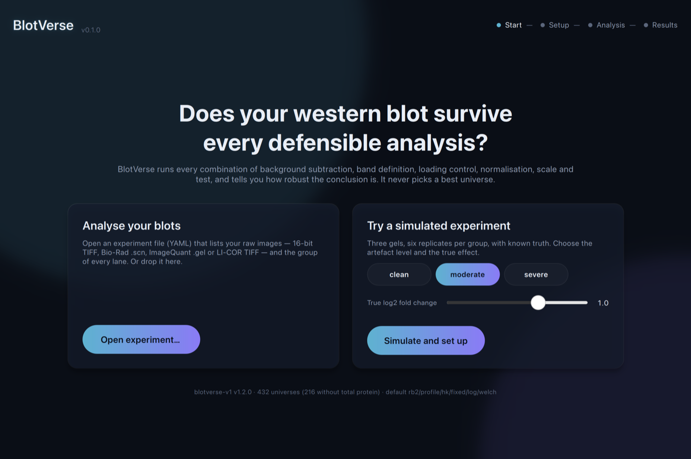
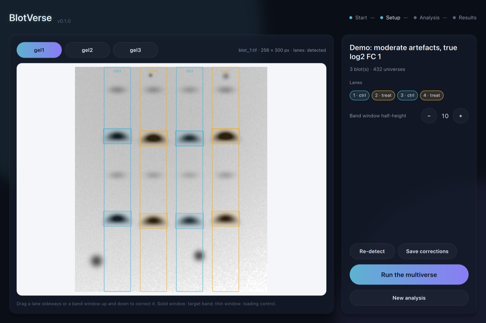
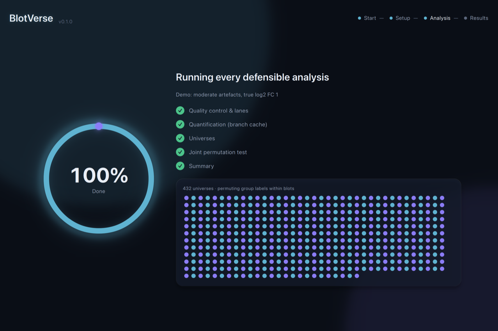
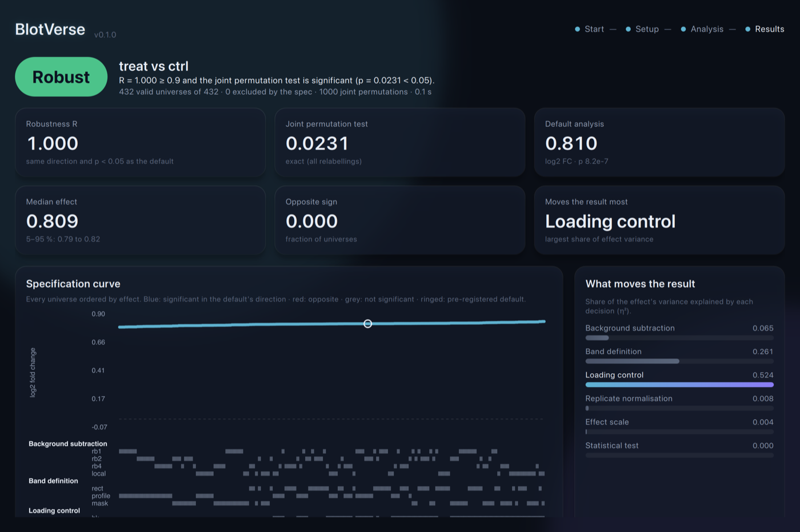

# BlotVerse

[](https://github.com/juvenalyosa/blotverse/actions/workflows/ci.yml)

**Does a western blot conclusion survive every defensible way of quantifying it?**

BlotVerse runs a *multiverse analysis* of western blot densitometry. Instead of
one analysis path, it runs every combination of defensible choices for
background subtraction, band definition, loading control, replicate
normalisation, effect scale and statistical test (432 "universes" with a
total-protein image, 216 without). It reports:

* a **robustness score R**: the fraction of universes that agree with the
  pre-registered default analysis (same direction, p < 0.05);
* the **distribution of the effect** (median log2 fold change and 5-95 % range);
* a **specification curve** showing every universe and the branches it uses;
* the **influence** of each decision (eta^2), i.e. which choice moves the result most;
* a **joint permutation test** and a one-word verdict: *Robust*, *Fragile*, *Not supported*,
  or *Not evaluable* when the design has too few lanes per blot to test robustness;
* a **reproducibility file** that regenerates every number exactly (same platform and
  compiler; across platforms, last-digit libm differences are possible).

It never suggests a "best" universe.

Motivation: applying different common densitometry procedures to the same blot
gave p-values from 0.000013 to 0.76 (Gassmann et al., 2009).

## Build

Requirements: a C++20 compiler, CMake >= 3.25, libtiff and Eigen 3.
yaml-cpp and doctest are fetched automatically at pinned versions.

```bash
# macOS
brew install cmake libtiff eigen
# Debian/Ubuntu
sudo apt-get install cmake libtiff-dev libeigen3-dev

cmake -S . -B build -DCMAKE_BUILD_TYPE=Release
cmake --build build -j
ctest --test-dir build --output-on-failure
```

## Quick start

```bash
# 1. Simulate an experiment with known truth (3 gels x 2 replicates, true log2 FC = 1)
build/apps/blotverse simulate --out demo --level moderate --lfc 1.0 --gels 3 --reps 2

# 2. Run the full multiverse
build/apps/blotverse run demo/experiment.yaml --out demo/report

# 3. Reproduce it exactly from the reproducibility file
build/apps/blotverse reproduce demo/report/repro.yaml
```

Outputs in `demo/report/`: `report.html`, `summary.csv`, `universes.csv`
(every universe), `lanes.csv` (band windows and raw signals per branch) and
`repro.yaml`.

## Desktop application

A Qt Quick application covers the whole workflow:

* open an experiment, or simulate one with known truth;
* check and correct the detected lanes and bands by dragging them;
* run the multiverse while live progress is shown;
* read the verdict, the specification curve and each decision's influence, then export
  the HTML report and the reproducibility file.

| | |
|---|---|
|  |  |
|  |  |

Build it with Qt >= 6.5 (`brew install qt`, or the Qt online installer):

```bash
cmake -S . -B build -DBLOTVERSE_BUILD_GUI=ON -DCMAKE_PREFIX_PATH=$(brew --prefix qt)
cmake --build build -j
open build/gui/BlotVerse.app        # macOS; build/gui/BlotVerse elsewhere
```

The application uses the same library, spec and files as the command line. Lane
corrections are saved to `<experiment>.annotated.yaml` next to the original, and exports
include `repro.yaml`. It never ranks universes or offers a "best" one. The interface is
in English; translations can be added through Qt Linguist, since every string goes
through `qsTr`.

## Analysing your own blots

Describe the experiment in YAML. Images must be raw greyscale acquisitions: Bio-Rad Image Lab
`.scn` (read natively), ImageQuant/Molecular Dynamics `.gel`, or TIFF.

* 16-bit is preferred; 8-bit, or upscaled 8-bit inside a 16-bit file, is accepted with a
  warning.
* JPEG, CMYK and pseudo-coloured files are rejected.
* Add `invert: true` to a blot whose image shows dark bands on a light background.

```yaml
name: my-experiment
control_group: ctrl
blots:
  - id: gel1
    image: gel1.tif                 # target and housekeeping bands
    total_protein: gel1_stain.tif   # optional, registered to gel1.tif
    bands: {target_y: 95, reference_y: 205}   # approximate rows (optional hints)
    lanes_x: [56, 344]              # centres of first and last sample lane (optional)
    # reference_image: gel1_actin.tif # loading control imaged separately (optional),
    # reference_annotation: {...}     #   with its own lanes and band rows
    lanes:                          # left to right
      - {group: ctrl, sample: c1}
      - {group: treat, sample: t1}
      - {group: ctrl, sample: c2}
      - {group: treat, sample: t2}
```

Check the automatic lane and band detection, and correct it by hand if needed.
`lanes_x` keeps ladders and blank lanes from misleading the lane fit. A quick look at a
single image: `blotverse lanes IMAGE --lanes N --target-y Y --reference-y Y`.

```bash
build/apps/blotverse detect my/experiment.yaml --out my/experiment_annotated.yaml
# edit the 'annotation' blocks, then:
build/apps/blotverse run my/experiment_annotated.yaml --out my/report
```

## The multiverse specification

`spec/multiverse.yaml` defines the six decisions, their branches (each with a
literature reference), the default universe, exclusion rules, QC and verdict
thresholds, and the seeds. Freeze and pre-register it (e.g. its SHA-256 on OSF)
before looking at validation results. `blotverse spec` prints a summary.

| Decision | Branches |
|---|---|
| Background subtraction | rolling ball with radius 1x, 2x, 4x band height; local background (same lane) |
| Band definition | fixed rectangle; lane-profile peak; Otsu threshold mask |
| Loading control | housekeeping protein; total protein (if imaged) |
| Replicate normalisation | fixed point (control); blot sum; optimal alignment (Degasperi 2014) |
| Effect scale | linear ratio; log ratio |
| Statistical test | Welch t; mixed model with random gel; permutation |

Default universe: `rb2 / rect / hk / fixed / log / welch` (spec v1.3.0; see [`docs/default_band_decision.md`](docs/default_band_decision.md)).

## Validation

Known amounts: `blotverse dilution CONFIG.yaml --out DIR` measures linearity and
known-fold-change recovery of every branch on a dilution series. It is applied to the
public LI-COR series of Pillai-Kastoori et al. (2020).

Exposure series: `blotverse exposure CONFIG.yaml --out DIR` takes one membrane imaged at
several exposures, where lane ratios must not change inside the linear range. It measures
how far each branch moves those ratios and whether the saturation QC flags every exposure
whose ratios are compressed. Protocol: [`docs/exposure_protocol.md`](docs/exposure_protocol.md);
results: [`docs/exposure_bench.md`](docs/exposure_bench.md).
To run it: `validation/exposure/run_all.sh`.

Published experiments (plan level 3): reanalysis of raw images deposited with articles,
compared with the authors' own quantification, in [`docs/level3.md`](docs/level3.md).

Real data: public raw 16-bit acquisitions, the simulator realism check (`blotverse
imagestats`) and lane detection against authors' Image Lab annotations are in
[`docs/real_data.md`](docs/real_data.md).

`blotverse validate` runs the level-1 validation (plan section 8): simulated
blots with known truth go through the complete tool. The latest results are in
[`docs/validation.md`](docs/validation.md). E6 (agreement with Fiji) needs Fiji
and is scripted in [`validation/fiji`](validation/fiji).

## Repository layout

See [`docs/architecture.md`](docs/architecture.md). The project plan (in
Spanish) is in [`docs/plan/BlotVerse_plan.txt`](docs/plan/BlotVerse_plan.txt).

## References

* Gassmann et al. 2009. Quantifying Western blots: pitfalls of densitometry. *Electrophoresis*.
* Degasperi et al. 2014. Evaluating strategies to normalise biological replicates of Western blot data. *PLOS ONE*.
* Misleading Westerns: common quantification mistakes in Western blot densitometry and proposed corrective measures, 2019.
* blotRig: improving rigor and reproducibility in western blot experiments. *Scientific Reports*, 2024.
* ImageJ `BackgroundSubtracter` (rolling-ball algorithm, Sternberg 1983).

## Authors

Juvenal Yosa, PhD and Jorge Leyva, PhD. See [CITATION.cff](CITATION.cff) for how to cite
BlotVerse.

## License

MIT. See [LICENSE](LICENSE).
